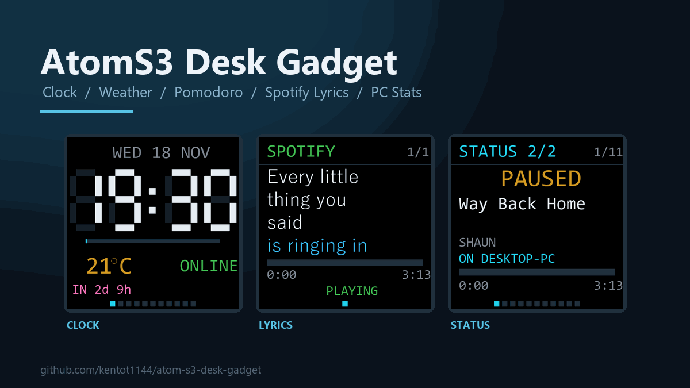
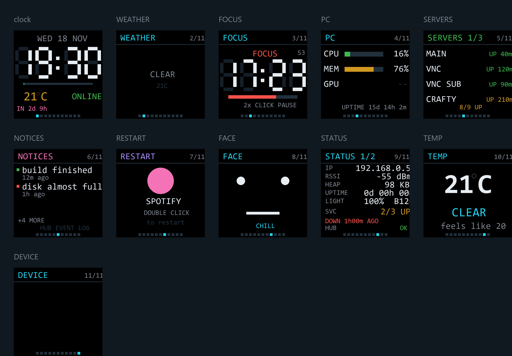
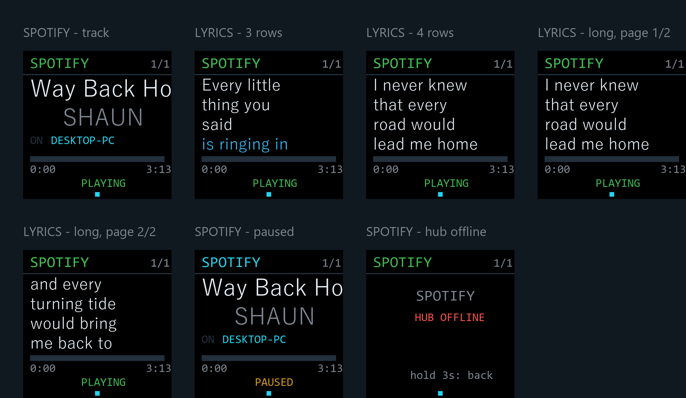
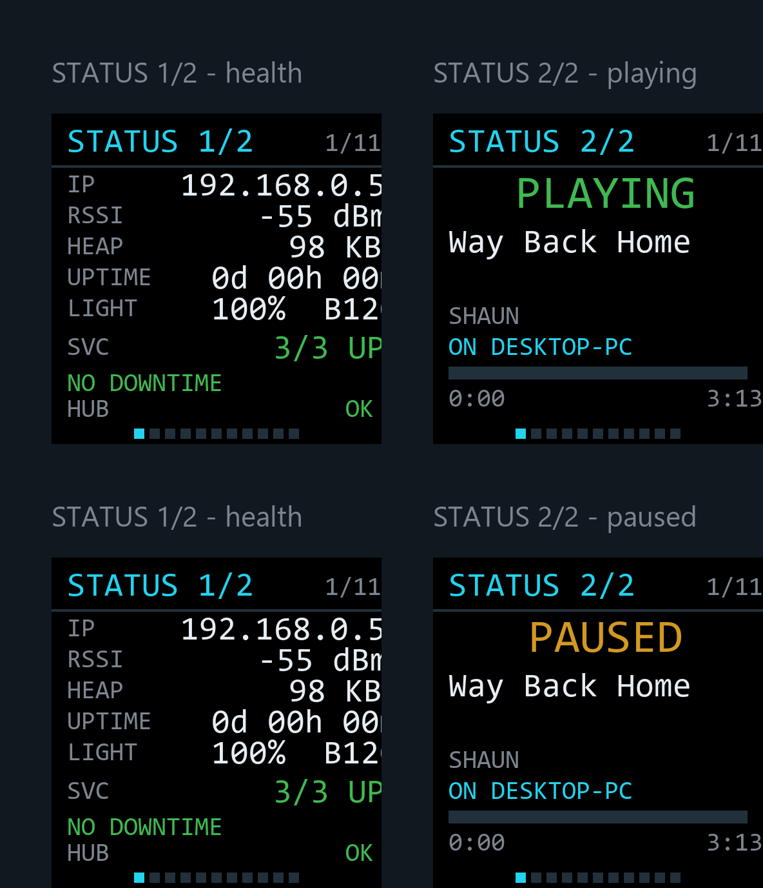
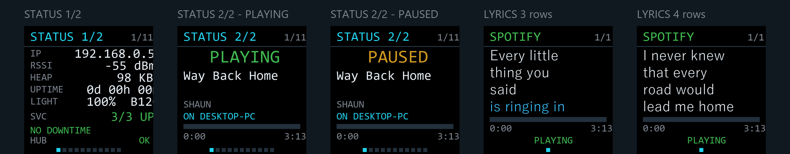

# AtomS3 Desk Gadget

A multi-functional desk gadget built with an M5Stack AtomS3 (MicroPython) and a
small Python hub that runs on a PC in the same LAN.

## Features

- **Clock & weather** on the 128x128 screen, plus a cute idle mascot. The
  forecast is fetched by the hub and published in the state stream, so the
  gadget itself never talks to the internet.
- **Hub-authoritative display**: the hub pushes one revisioned state object
  over a long-lived `/stream` connection; the gadget only renders it. Pages,
  Spotify state and alerts never advance or change on their own.
- **Next calendar event**: the clock page shows a countdown to the next event
  from any iCalendar (ICS) feed. No Google/Microsoft OAuth is needed; the hub
  parses the feed including the common `RRULE` cases.
- **PC stats** (CPU, RAM, GPU, uptime) served by the local hub.
- **Service monitoring**: HTTP / TCP / Minecraft checks with alert rules.
  Minecraft player counts come from the Crafty API, and join/leave/move events
  are pushed into the notification center.
- **Notification center**: `POST /notify` on the hub, and the device shows a
  dismissable full-screen banner, flashes the LED and keeps the last 20 events
  on a NOTICES page. Minecraft joins and leaves are generated automatically.
- **Service uptime sparkline** on the STATUS page, plus the last time a service
  went down. The STATUS page also alternates every 5 s with a bare Spotify panel
  (state, track, artist, device and progress), so playback is visible without
  leaving the page ring.
- **Alert LED** on GPIO5 flashes when a critical service is down.
- **Auto-brightness** from the on-board light sensor (GPIO6).
- **Spotify screen**: shows track, artist and the playing device, with
  play/pause, next and previous controls on the device button. Track and artist
  use a CJK font (Latin, kana and kanji) on a single clipped line; long text
  slides sideways and bounces back like a radio VFD (30 fps animation), while
  track data refreshes at 5 fps. Only the text band and the progress area are
  repainted, so the screen does not flash.
- **Synced lyrics**: hold the button for ~1 s on the Spotify screen to overlay
  a teleprompter of the current line plus the two coming lines, fetched from
  [LRCLIB](https://lrclib.net/) through the hub. The sung row is white and the
  coming lines are sky blue. Every ~4 s the device re-reads the line at its own
  playback position, so it stays aligned with Spotify. Every lyric row uses the
  same mid-size CJK font (0.7) on an even 17 px pitch, so rows never change size
  or jump between lines. A line wider than the panel continues on the next row
  (Latin words kept whole, CJK split per character), so the sentence keeps its
  order instead of being cut off. Up to four rows fit at once; a longer line is
  paged through over time so its tail is still shown. In lyrics mode the top
  strip replaces the `SPOTIFY` label with a sliding `track - artist` marquee.
  The hub keeps a monotonic playback clock, so a stale Spotify connect-state
  frame cannot rewind the bar or the lyric line (nor be mistaken for a pause
  while music is still playing).
- **Remote Spotify restart**: a Normal-mode page that kills and relaunches the
  Spotify desktop app on the hub PC, for when it hangs and needs an Alt+F4.
  Ten seconds after the request the device polls playback for six seconds and
  reports SYNCED, or NOT SYNCED when the song is not actually moving.
- **Several remembered Wi-Fi networks**: list every SSID/password pair you use.
  While disconnected the device scans for visible known networks, connects to
  home first and otherwise to the strongest one, then falls back to trying the
  configured list. `tools/wifi_import.py` copies every saved Windows profile
  into `config.json` in one go.

## Preview

Every image below is rendered from the real page code with `tools/gallery.py`
and `tools/preview.py` against a fake board, so no hardware is needed to see
the layout, colours and font sizes the device actually draws.



### Normal mode

Clock, weather, pomodoro, PC stats, servers, notices, mascot, restart and status:



### Spotify mode and lyrics

Track page, short/wrapped/paged lyrics, paused and hub-offline states:



### Status sub-pages

The health page and the bare Spotify page it alternates with:



### Overview



## Share on UIFlow2

Want to publish this to M5Stack's UIFlow2 **Project Zone**? See
[docs/UIFLOW.md](docs/UIFLOW.md) for the paste-ready project description and
publish steps. Two safe ways to load the device code are provided:

- [`uiflow/AtomS3DeskGadget.m5f2`](uiflow/AtomS3DeskGadget.m5f2) — import it
  directly in UIFlow2 (**Import → Import project from local file**). The
  filename is letters/numbers only because UIFlow2 rejects non-ASCII names.
  The launcher writes the split modules to flash on first run.
- [`uiflow/atoms3-desk-uiflow.zip`](uiflow/atoms3-desk-uiflow.zip) — upload the
  files manually if the `.m5f2` launcher runs out of heap.

Neither contains credentials — create your own `config.json` locally.

## Two UI modes

| Mode | Screens |
| --- | --- |
| Normal | clock, weather, pomodoro, PC stats, services (4 per page), notices, restart Spotify, mascot, status |
| Spotify | track, artist, device, progress bar |

Switch between them with a **3 second button hold**. In Normal mode:

| Gesture | Action |
| --- | --- |
| single click | next page |
| double click | page action (refresh, clear notices, restart Spotify, ...) |

While a notification banner is visible, any click dismisses it. In Spotify mode:

| Gesture | Action |
| --- | --- |
| single click | play / pause |
| double click | next track |
| triple click | previous track |
| hold ~1 s | show / hide lyrics |

## Project structure

```text
firmware/            MicroPython code for the AtomS3
  boot.py main.py    entry points
  config.json        Wi-Fi, location, hub URLs, pins (copy from .example)
  app.py             thin entry point; imports the desk package
  desk/              the display client, split to fit the small heap
    const.py         shared constants and the fallback page ring
    ui.py            palette, fonts, drawing primitives
    wifi.py          Wi-Fi scanning and roaming (home first)
    hub.py           HTTP polling, DNS cache, target failover
    pom.py           pomodoro, auto-brightness, alert LED
    spot.py          Spotify state machine (scroll + lyric sync)
    spotdraw.py      Spotify page renderer
    draw.py          renderers for the hub-driven pages
    loop.py          main loop, input gestures, notifications
    app.py           app state, wiring, run()
hub/                 PC-side hub
  hub.py             HTTP server: /state, /stream, /stats, /events, /notify,
                     /calendar, /spotify_*, /lyrics
  spotify_bridge.py  Spotify backend (SMTC by default)
  hub_config.json    services + keys (copy from .example)
  start_hub.bat      silent launcher (hands off to the VBS)
  start_hub_silent.vbs  fully window-less launcher
  start_hub_debug.bat   visible console with logs (for debugging)
  check_hub.vbs      silent watchdog: restarts the hub if it stops answering
  install_hub.bat/.ps1  firewall rule + silent autostart + watchdog task
tools/               flashing and network diagnostics helpers
  push.py            flash firmware/ over the serial REPL
  wifi_import.py     merge every saved Windows Wi-Fi profile into config.json
  render_test.py     render every page against a fake board (UI smoke test)
  preview.py         paint the STATUS sub-pages to a PNG (needs pillow)
```

The firmware is split into small modules on purpose. MicroPython compiles a
whole file before running it, and UIFlow2 2.3.1 only leaves about 112 KB of
heap at boot; a single large `app.py` cannot be compiled there. Keep new
modules under roughly 12 KB and import nothing at boot time that is not
needed immediately.

After touching a renderer, run `python tools/render_test.py` to draw every page
against a fake board, and `python tools/preview.py out.png` to paint the STATUS
sub-pages to an image (`pip install pillow`).

## Setup

### 1. Device

1. Install the UIFlow2 firmware on the AtomS3 (the stock environment can be
   restored at any time from UIFlow2).
2. Copy `firmware/config.json.example` to `firmware/config.json` and fill in
   the timezone (`location.tz`), the hub URL(s) and one or more Wi-Fi networks:

   ```json
   "wifi": [
     { "ssid": "home", "password": "..." },
     { "ssid": "phone hotspot", "password": "..." }
   ]
   ```

   A single object (`{"ssid": ..., "password": ...}`) still works. While
   offline the device scans for visible known networks, tries home (the first
   entry) first and otherwise the strongest signal, then falls back to the
   configured list.

   On Windows, every profile saved on the PC can be imported at once
   (the file is local and never committed):

   ```bat
   python tools\wifi_import.py
   python tools\wifi_import.py --home YOUR_HOME_SSID
   ```

   The hub can also be found automatically. Add its MAC address to pin the
   right PC (optional but recommended):

   ```json
   "hub": {
     "urls": ["http://192.168.1.10:8765"],
     "mac": "00:11:22:33:44:55",
     "discovery_port": 8766
   }
   ```

   When none of the `urls` answers, the device broadcasts a UDP packet on
   port 8766. The hub replies with its port and MAC addresses, so a DHCP
   address change no longer breaks PC stats or Spotify. With `mac` set, only
   that machine is accepted; leave it empty to accept any hub. `host_mac` in
   `/stats` shows the PC's MAC. Discovery needs direct device-to-PC traffic:
   guest Wi-Fi with AP isolation blocks both the hub and discovery.
3. Flash with:

   ```bat
   python tools\push.py
   ```

   The script writes every file under `firmware/` to `/flash` over the serial
   port and reboots the device. Set the `PORT` environment variable if your
   board is not on `COM3`.

### 2. Hub (PC)

1. Install Python 3.10+ and `pip install psutil`.
2. Copy `hub/hub_config.json.example` to `hub/hub_config.json` and replace every
   placeholder (`YOUR_...`) with your own URLs, IPs and API key. Set
   `"location": {"lat": ..., "lon": ...}` so the hub can fetch the local
   forecast (open-meteo, no API key) for the `wx` state section.
3. Double-click `hub/start_hub_silent.vbs` (or run `hub/install_hub.bat` once to
   add the firewall rule, a silent autostart shortcut and a watchdog task).
4. Open <http://localhost:8765/stats> to check it works.

The hub is single-instance: if another copy is already listening on port 8765,
a new copy prints a message and exits instead of competing for requests.
`check_hub.vbs` runs every 2 minutes from Task Scheduler; if `/ping` does not
answer, it starts the hub again. It is windowless, like the launcher.

To update the Spotify bridge on a running hub, use the deploy helper on the hub
PC. It backs up the current file, installs the fixed one, restarts the hub and
waits for `/ping`:

```bat
python tools\deploy_hub.py --dry-run
python tools\deploy_hub.py --yes
python tools\deploy_hub.py --yes --watch   REM pause/resume Spotify while watching
```

`--probe-only` only prints the live Spotify state. `--source` accepts a local
file or URL instead of the copy in this repo.

#### Reaching the hub over the internet

Run the hub on the machine that stays on (for example a home server) and add
its public address as a second URL. Order matters: LAN first, public second,
so at home the device stays local.

```json
"hub": {
  "urls": ["http://192.168.1.10:8765", "http://YOUR_DDNS_HOST:8765"],
  "token": "CHANGE_ME_LONG_RANDOM_TOKEN",
  "discovery_port": 8766
}
```

Put the same string in `hub_config.json` as `"token"`. When a token is set,
every request except `/ping` needs `?k=TOKEN`; the firmware appends it
automatically. **Never expose the hub without a token** — port 8765 has no
TLS, so the token is the only protection. Open the ports on the hub PC:

```bat
netsh advfirewall firewall add rule name="AtomS3 Hub 8765" dir=in action=allow protocol=TCP localport=8765
netsh advfirewall firewall add rule name="AtomS3 Hub discovery 8766" dir=in action=allow protocol=UDP localport=8766
```

If the PC is behind a router, forward TCP 8765 to it (and UDP 8766 for LAN
discovery). The Spotify page polls faster on a LAN and backs off to 2 Hz when
the round trip is slow, so the marquee keeps its frame rate over the internet.

### 3. Service checks

`hub/hub_config.json` describes what to monitor. Supported types:

- `http` – up when the status code is below 500 (redirects are not followed)
- `tcp` – up when the TCP port accepts a connection
- `mc` – Minecraft server list ping

Each service may list several `hosts`; the first one that answers wins. Mark a
service `"critical": true` to make the device LED flash when it is down.

For live Minecraft numbers, add `"crafty": "<server name or id>"` to an `mc`
service. The hub reads `/api/v2/servers/<id>/stats` from Crafty, which returns
the running state, player count and player names. The legacy server-list ping
(`type: "mc"` without `crafty`) still works and only reports counts.

### 4. Notifications and calendar

The hub keeps a small in-memory event log:

- `POST /notify` with a JSON body `{"title": "...", "body": "...", "kind": "manual"}`.
  `GET /notify?title=...&body=...&kind=...` also works.
- `GET /events?since=<last id>` returns `{"now", "last", "events": [...]}`.
  Event ids restart at 1 when the hub restarts; the device notices a smaller
  `last` and replays from zero. The state stream already carries the latest
  events, so this endpoint is kept for scripts and older devices.
- `GET /calendar` returns the next event parsed from the ICS feed, or
  `{"status": "disabled"}` until `calendar.ics_url` is set. The same object is
  published in the `cal` section of the state stream.

```bash
curl -X POST http://192.168.1.10:8765/notify?k=TOKEN \
     -H "Content-Type: application/json" \
     -d '{"title":"Build done","body":"CI finished in 2m","kind":"manual"}'
```

The gadget receives new events inside the state stream, shows an LED-flashing
banner for ~9 seconds (a click dismisses it), and keeps the latest 20 events on
the NOTICES page. Double click on that page clears the local list. `events.keep`
in `hub_config.json` controls how many events the hub retains.

Minecraft joins, leaves and server moves become `mc_join`, `mc_leave` and
`mc_move` events automatically. If a Crafty request times out, the hub keeps the
last known player list for that server, so a slow API never looks like a mass
disconnect.

For the calendar countdown, set the feed and the fixed UTC offset:

```json
"calendar": {
  "ics_url": "https://calendar.example.com/private/feed.ics",
  "tz_offset": 9,
  "days": 14
}
```

Most calendar services offer a secret/public ICS address (Google Calendar:
"Secret address in iCal format"; Outlook: publish calendar). The hub refreshes
the feed at most once a minute and publishes the next event in the state stream.
The common `RRULE` cases (daily, weekly with `BYDAY`, monthly, yearly,
`INTERVAL`, `COUNT`, `UNTIL`) are expanded locally. No OAuth token is stored.

### 5. Spotify

Two backends are supported, chosen automatically:

1. **SpotAPI** – preferred when `hub/spotify_cookies.json` exists (see
   [Aran404/SpotAPI](https://github.com/Aran404/SpotAPI)). It talks to Spotify's
   own connect-state endpoint, so titles and artists are canonical and the
   lyrics lookup works in every language.
2. **Windows media sessions (SMTC)** – the fallback. Works with the Spotify
   desktop app and browser tabs, no login required, but Windows localizes
   artist names (which can defeat lyrics matching).

If the SpotAPI call fails, the hub falls back to SMTC and retries SpotAPI a few
minutes later. Lyrics come from the free [LRCLIB](https://lrclib.net/) API,
cached per track, with a duration-matched search fallback for localized names.
The hub owns the authoritative playback position and publishes the current line
and the two coming lines in the `ly` section. `/lyrics?pos=<ms>` remains for
compatibility.

A paused track must never look like it is playing. The bridge treats
`is_paused` as authoritative and also watches the position: a real playing track
advances roughly once per second, while a paused one only jitters. If the
reported position is frozen over a six-second window, `is_playing` is cleared
even when Windows still says playing. A seek or track change resets the window,
and playback that resumes clears the stall within a few seconds. The device
repeats the same check locally, so an older hub build cannot keep the progress
bar moving. The bar is green while playing and amber while paused.

## Device state stream

The gadget is a pure display: every page reads one snapshot and never combines
endpoints or changes mode/page on its own. The hub splits that snapshot into
seven sections, each with its own revision:

| Section | Contents |
| --- | --- |
| `pc` | CPU, memory, GPU, uptime, host |
| `svc` | service checks, alert ids, player list, per-service uptime |
| `sp` | Spotify status, track, device and progress anchor |
| `ly` | current lyric line and the two coming lines |
| `cal` | next calendar event |
| `ev` | last event id and the latest 10 events |
| `wx` | current conditions and today's min/max (open-meteo, wttr.in fallback) |

The device makes no outbound internet requests while it can reach the hub:
weather, calendar, time, Spotify and notifications all arrive inside the
snapshot. NTP is only used as a first-boot fallback before the hub has ever
answered. This keeps a weak or filtered Wi-Fi link from turning a DNS lookup or
a failed TLS handshake into a stall on the display.

- `GET /state` returns the full snapshot, or only the sections whose revision
  is newer than the caller's `r_<section>` query values.
- `GET /stream` keeps the connection open and writes one JSON delta per line
  (NDJSON) whenever a section changes, plus a one-second heartbeat. The hub
  closes the connection after a write timeout; the device reconnects with
  backoff and falls back to `/state` if the stream cannot be established.
- The progress position is anchored by the hub and interpolated locally by the
  device between anchors. The device never decides which lyric line is current.
- `sp` and `svc` revisions use a ten-second bucket so small progress/uptime
  changes do not flood the stream. `cal` omits the countdown and `ly` omits the
  anchor time; the device derives both from the included timestamp. `wx` omits
  the fetch time, so the revision changes only when the forecast does.

## Security

**Never commit real configuration files.** `hub_config.json`,
`firmware/config.json`, `spotify_cookies.json` and the cookie export tool can
contain API keys, internal IPs and account cookies. They are listed in
`.gitignore`; use the provided `*.example` templates instead.

If a key was ever committed, revoke/regenerate it — deleting the file later
does not remove it from Git history.

## License

MIT
